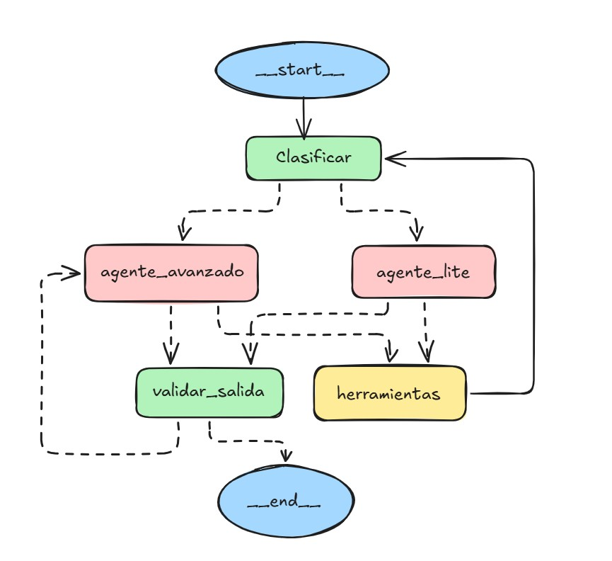

# ⚛️ Proyecto IA-Gen: Asistente Experto en Física Nuclear y de Partículas

Este repositorio contiene la implementación completa de un **Asistente Experto en Física Nuclear y de Partículas Subatómicas**, diseñado como un agente RAG (Retrieval-Augmented Generation) condicional con memoria conversacional y enrutamiento por complejidad. El proyecto está construido utilizando **LangGraph**, **Google Gemini**, **ChromaDB** y administrado mediante el gestor de paquetes **`uv`**.

---

## 📌 1. Descripción del Dominio y Contexto

El asistente está especializado en el dominio científico y académico de la **Física Nuclear y de Partículas**. Ofrece soporte técnico, resolución de dudas conceptuales, explicaciones de modelos nucleares y deducciones matemáticas formales a partir de la documentación original de la asignatura.

### Características Clave:
* **Ejecución Unificada:** El proyecto completo está integrado y documentado en un único cuaderno Jupyter ejecutable (`notebooks/agente_fisica.ipynb`).
* **Estrategia Dual de Embeddings:** Permite alternar libremente entre embeddings en la nube (`models/gemini-embedding-2`, $3072$ dimensiones) y embeddings locales (`sentence-transformers/all-MiniLM-L6-v2`, $384$ dimensiones) para operar de forma independiente a la cuota de la API.
* **Formalismo Matemático Riguroso:** Notación `LaTeX` formal obligatoria para magnitudes, constantes, relaciones cinemáticas y ecuaciones de desintegración (ej. $E = mc^2$, $\beta^-$, $^{235}_{92}\text{U}$).
* **RAG Condicional y Modular:** Lógica de herramientas desacoplada del *retriever* concreto (`buscar_apuntes_fisica` para teoría general y `buscar_formulas_y_ecuaciones` para expresiones matemáticas).
* **Router de Complejidad Dinámico:** Clasificación inicial de la consulta (`nodo_clasificar`) para derivar la inferencia entre un modelo liviano (`gemini-3.5-flash-lite`) o uno avanzado (`gemini-3.5-flash`).
* **Inspección y Guardarraíles de Salida:** Validador heurístico para detectar y corregir respuestas incompletas o cortadas antes de entregar el resultado al usuario.
* **Memoria Conversacional Persistente:** Retención de contexto mediante `MemorySaver` de LangGraph identificado por `thread_id`.

---

## 📂 2. Estructura del Repositorio

```text
proyecto_IAgen/
├── .venv/                   # Entorno virtual gestionado por uv (ignorado en git)
├── assets/                  # Recursos gráficos e imágenes del proyecto
│   └── Esquema_nodos.jpg    # Diagrama de flujo y topología del agente en LangGraph
├── chroma_db/               # Bases de datos vectoriales persistentes (ChromaDB)
│   ├── chroma_db_fisica_api/
│   └── chroma_db_fisica_HF/
├── documentation/           # Apuntes universitarios originales en PDF
│   ├── apuntes_nuclear_corregidos.pdf
│   └── fnp2.pdf
├── notebooks/               # Cuaderno Jupyter ejecutable con el proyecto completo
│   └── agente_fisica.ipynb
├── .env                     # Variables de entorno (API Key - ignorado en git)
├── .gitignore               # Exclusiones de control de versiones
├── .python-version          # Versión de Python fijada
├── pyproject.toml           # Configuración del proyecto y dependencias de uv
├── README.md                # Documentación principal del proyecto
└── uv.lock                  # Bloqueo de versiones exactas de uv
```

---

## ⚙️ 3. Requisitos e Instalación

El proyecto utiliza [**`uv`**](https://github.com/astral-sh/uv) para la gestión ultra-rápida de entornos virtuales y dependencias en Python.

### Paso 1: Clonar el repositorio
```bash
git clone <https://github.com/PabloMR-84/asistente-fisica-nuclear>
cd proyecto_IAgen
```

### Paso 2: Crear el entorno virtual e instalar dependencias con `uv`
```bash
# Crear el entorno virtual con la versión de Python del proyecto
uv venv

# Activar el entorno virtual (Linux/macOS)
source .venv/bin/activate

# Activar el entorno virtual (Windows PowerShell)
.venv\Scripts\activate

# Sincronizar e instalar todas las dependencias exactas desde pyproject.toml
uv sync
```

---

## 🔑 4. Configuración de Variables de Entorno

Crea un archivo `.env` en la raíz del proyecto (`proyecto_IAgen/.env`) con tu clave de API de Google Gemini:

```env
# Clave API de Google Gemini (requerida para inferencia y embeddings de Gemini)
GEMINI_API_KEY=tu_api_key_aqui
```

---

## 🎯 5. Justificación del System Prompt y Guardarraíles

El `SYSTEM_PROMPT` establece los límites operacionales y la personalidad académica del tutor:

```text
Eres un Tutor Experto en Física Nuclear y de Partículas Subatómicas.
Tu objetivo es responder a las dudas teóricas, matemáticas y conceptuales con rigor académico.

REGLAS DE ACTUACIÓN:
1. FORMALISMO MATEMÁTICO: Utiliza notación LaTeX formal para magnitudes, símbolos y fórmulas físicas (ej. $E=mc^2$, $\beta^-$, $^{235}_{92}\text{U}$). En respuestas conceptuales o breves, limita el uso de LaTeX a los símbolos necesarios sin incluir desarrollos matemáticos no solicitados.
2. USO DE HERRAMIENTAS: Utiliza 'buscar_apuntes_fisica' para teoría general y 'buscar_formulas_y_ecuaciones' cuando la consulta requiera expresiones matemáticas o valores numéricos concretos.
3. GUARDARRAÍLES Y LÍMITES: Si la pregunta está fuera del dominio de la Física o no se encuentra en la base de conocimiento, indícalo educadamente sin inventar información.
4. TONO: Riguroso, pedagógico, claro y estructurado.
```

### Justificación Técnica:

1. **Control de Alucinaciones:** Exige la recuperación explícita de documentos antes de proporcionar constantes o fórmulas concretas de la asignatura.
2. **Formato Científico Standard:** Asegura la legibilidad de expresiones matemáticas mediante notación `LaTeX` inline ($...$) o en bloque ($$...$$).
3. **Guardarraíles de Dominio:** Restringe las interacciones a la Física, rechazando amablemente peticiones fuera del ámbito de conocimiento.

---

## 🧱 6. Arquitectura del Agente (LangGraph)

El agente se organiza como un grafo de estado dirigido (`StateGraph`) en LangGraph con la siguiente topología de ejecución:

<p align="center">
  
</p>

### Descripción del Flujo de Nodos:
* **`__start__` $\rightarrow$ `Clasificar`:** Punto de entrada donde un clasificador ligero asigna el nivel de complejidad (`simple` vs `compleja`).
* **`agente_lite` / `agente_avanzado`:** Nodos de inferencia que seleccionan entre `gemini-3.5-flash-lite` o `gemini-3.5-flash` según la ruta asignada.
* **`herramientas`:** Nodo ejecutable de RAG que realiza búsquedas en ChromaDB (`apuntes_nuclear_corregidos.pdf` y `fnp2.pdf`) y devuelve el contexto al router.
* **`validar_salida` $\rightarrow$ `__end__`:** Inspección heurística de finalización de frase para asegurar respuestas integrales antes de concluir la ejecución.

---

## 🧪 7. Batería de Pruebas Integrada

El cuaderno incluye una batería de pruebas de 10 casos diseñados para validar todos los componentes del sistema:

1. **Caso 1 (Consulta Conceptual General):** Diferenciación entre leptones y hadrones en el Modelo Estándar (Ruta Lite).
2. **Caso 2 (Consulta Documental RAG):** Recuperación de los términos de la fórmula semiempírica de Bethe-Weizsäcker.
3. **Caso 3 (Desarrollo Matemático Complejo):** Cinemática detallada de la desintegración $\beta^-$ en notación `LaTeX`.
4. **Caso 4 (Ecuaciones Específicas):** Definición formal de la anchura de resonancia y distribución de Breit-Wigner.
5. **Caso 5 (Modelo Físico Complejo):** Origen del término espín-órbita en el modelo de capas y operador $V_{so}(r)$.
6. **Caso 6 (Memoria Conversacional Nivel 1):** Pregunta de seguimiento sobre el neutrino/antineutrino conservador de momento.
7. **Caso 7 (Memoria Conversacional Nivel 2):** Explicación de la baja sección eficaz de interacción de dicha partícula.
8. **Caso 8 (Guardarraíl de Dominio):** Rechazo educado ante consultas ajenas a la asignatura (ej. recetas de cocina).
9. **Caso 9 (Guardarraíl contra Alucinaciones):** Verificación de límites ante datos no presentes en la documentación.
10. **Caso 10 (Consulta Mixta Electrodébil):** Relación entre los bosones $W^0, B^0$ y el fotón a través del ángulo de Weinberg $\theta_W$.

---

## 🛠️ 8. Ejecución del Proyecto

Dado que el proyecto completo está autocontenido en el cuaderno Jupyter, puedes iniciarlo ejecutando:

```bash
# Abrir Jupyter Lab en el entorno virtual gestionado por uv
uv run jupyter lab
```

1. Navega a la carpeta `notebooks/` y abre el archivo **`agente_fisica.ipynb`**.
2. Asegúrate de tener seleccionado el Kernel del entorno virtual (`.venv`).
3. Ejecuta las celdas en orden secuencial para inicializar las bases vectoriales, compilar el grafo de LangGraph y ejecutar la batería de pruebas interactiva.

---

## 👤 Autor
- **Pablo Muñoz**
*Data Science & AI Engineering / Generative AI & Agents*